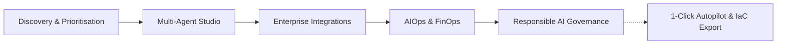
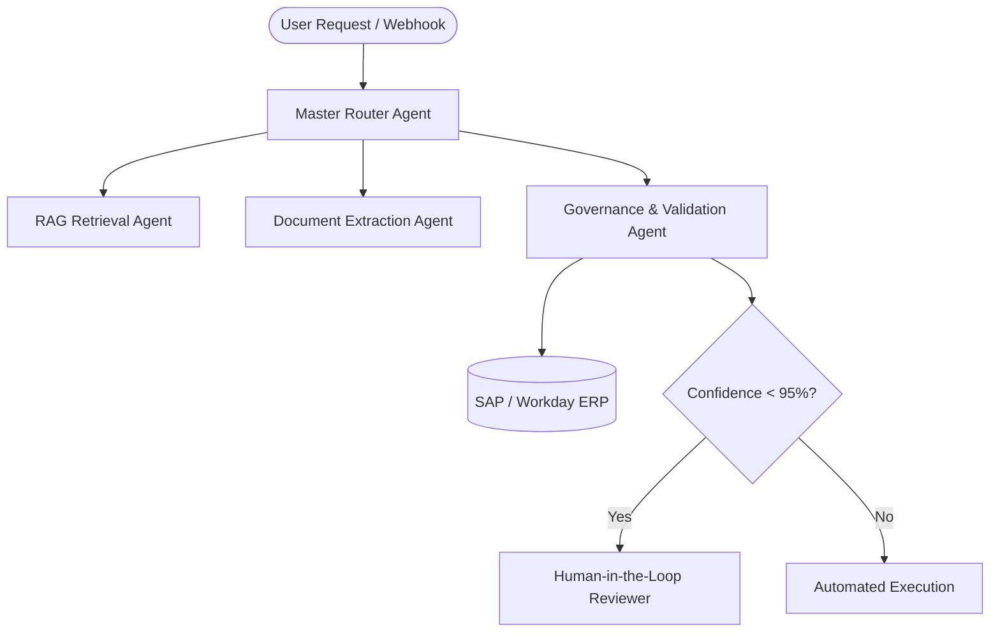

# Nexus AI Strategist Hub — End-to-End User Guide

Welcome to the **Nexus AI Strategist Hub**. This guide takes you step-by-step through every capability of the application, designed specifically for enterprise **AI Strategists, Heads of Intelligent Automation, and Transformation Leaders**.

---

## 🧭 Navigation & Overview

The platform is organised around the five foundational pillars of enterprise AI strategy, accessible from the left-hand navigation sidebar:

| Navigation Tab | Shortcut | Key Purpose |
| :--- | :--- | :--- |
| **Discovery & Prioritisation** | Top nav / `Esc` | Strategic opportunity intake, 2x2 Value vs Complexity matrix, ROI calculator, and Horizon roadmap. |
| **Multi-Agent Solution Studio** | Sidebar | Visual orchestration of multi-agent workflows, pattern templates, and prompt configuration. |
| **Enterprise Integrations** | Sidebar | Systems of record connectivity (SAP, Salesforce, Workday, ServiceNow, Microsoft 365, etc.). |
| **AIOps & FinOps** | Sidebar | Real-time token economics, latency monitoring, model drift detection, and budget alerts. |
| **Responsible AI Governance** | Sidebar | EU AI Act compliance checks, risk tier scoring, ethical guardrails, and audit trails. |
| **Microsoft Graph AI Co-Pilot** | Top Bar (`Ctrl+K` / Sparkle Icon) | Transcript ingestion & synthesis, targeted stakeholder email dispatch, and 1-click strategy autopilot. |

---

## ⚡ Quick Start: 3 Fast Ways to Drive Outcomes

If you want immediate results with minimal manual typing:

1. **Press `Ctrl+K`** (or click **AI Co-Pilot** in the top bar) and select **"1-Click Strategy Autopilot"** to auto-generate initiatives, synthesis, and compliance reviews in 3 seconds.
2. **Click "+ New Initiative"** and choose any of the **1-Click Scenario Magic Fill** chips (`Finance AP Automation`, `HR Talent Matching`, `Supply Chain Predictor`, `Legal Contract Review`) to pre-populate an enterprise-grade initiative.
3. **Open the Meeting Transcript Synthesizer** tab in the Co-Pilot to ingest Teams transcripts and convert spoken discussions into approved initiatives with a single click.

---

## 1. Discovery & Opportunity Prioritisation

The **Discovery** workspace enables you to evaluate, score, and prioritize enterprise AI initiatives according to business value, implementation complexity, and risk tier.

### Step 1.1: Review the 2x2 Value vs Complexity Matrix
- Locate the interactive **2x2 Prioritisation Matrix** at the top of the Discovery dashboard.
- Initiatives are segmented into four strategic quadrants:
  - **Quick Wins** (High Value, Low Complexity) — immediate candidates for Q1 rollout.
  - **Strategic Bets** (High Value, High Complexity) — multi-month transformative initiatives.
  - **Low-Hanging Fruit** (Low Value, Low Complexity) — tactical automations.
  - **Deprioritised / Re-evaluate** (Low Value, High Complexity) — paused initiatives.
- Click any bubble on the matrix or card in the table to open its detailed metadata, risk profile, and architecture.

### Step 1.2: Add an Initiative (Manual or 1-Click Magic Fill)
1. Click the **"+ New Initiative"** button in the top right.
2. **Magic Fill (Zero Typing):** Click any pill at the top of the modal:
   - `⚡ Finance AP Automation`
   - `⚡ HR Talent Matching`
   - `⚡ Supply Chain Predictor`
   - `⚡ Legal Contract Review`
   All fields (Title, Business Function, Target Platform, Strategic Alignment, Estimated ROI, Investment, Risk Category, and Architecture) will populate instantly with realistic enterprise benchmarks.
3. **Manual Entry:** Complete the form fields:
   - **Business Function**: Finance, HR, Supply Chain, Legal, Operations, Customer Service.
   - **Target Enterprise AI Platform**: Azure AI Foundry, Microsoft Copilot Studio, Power Platform, UiPath, or Custom Agent Fabric.
   - **Complexity & Impact Sliders**: Adjust 1–10 to reposition the initiative on the 2x2 matrix.
4. Click **"Save Initiative"**. The portfolio metrics and chart updates dynamically.

### Step 1.3: Filter and Search Portfolio
- Use the **Business Function filter dropdown** to narrow down initiatives by department.
- Use the **Risk Tier pills** (All, Minimal, Limited, High) to inspect regulatory exposure.
- Use the **Global Search bar (`Ctrl+/`)** to search across initiatives, models, agents, and systems of record simultaneously.

---

## 2. Microsoft Graph AI Co-Pilot (Transcript & Stakeholder Engine)

Nexus features direct, real-time integration with **Microsoft Graph API**, allowing you to bridge Microsoft Teams, Outlook, and Microsoft 365 directly into your AI roadmap.

### Step 2.1: Open the Co-Pilot Modal
- Click the **"✨ AI Co-Pilot"** button in the header, or press **`Ctrl+K`**.
- The header displays the live Graph API tenant connection status:
  - `Tenant: GraspAI (OpenClaw)`
  - `Roles: OnlineMeetingTranscript.Read.All, Mail.Send, Mail.Read, User.Read.All`
  - `Latency: ~260ms`

### Step 2.2: Ingest & Synthesize Meeting Transcripts
1. Switch to the **"Teams Meeting Ingestion"** tab.
2. Select any recent meeting transcript from the dropdown (e.g. *Q3 Finance Operations & AP Invoice Processing SteerCo*, *Customer Care Support Automation Working Group*, or *Supply Chain Logistics Optimization Planning*).
3. Click **"⚡ Synthesise Transcript with AI"**.
4. The Co-Pilot processes the spoken dialogue and extracts:
   - **Identified Opportunity**: Business problem and proposed solution.
   - **Target Enterprise Platform**: Recommended deployment target (e.g. UiPath + Azure Document Intelligence).
   - **Estimated Commercial Impact**: ROI and annual savings calculation.
   - **Key Stakeholders & Governance Flags**: Compliance, security, and human-in-the-loop requirements.
5. Click **"Apply to Portfolio as New Initiative"** to save the synthesized opportunity directly into your Discovery backlog.

### Step 2.3: Targeted Stakeholder Questionnaire (Email Dispatch)
1. Switch to the **"Stakeholder Questions"** tab.
2. Select an initiative to investigate (e.g. *Finance Invoice AI Agent* or *HR Talent Copilot*).
3. The AI pre-drafts targeted discovery questions across:
   - Volume & frequency
   - Systems of record (SAP, Workday, etc.)
   - Compliance & sensitive data constraints
   - Business value & success metrics
4. Choose the stakeholder recipient (CFO, VP Talent, Supply Chain Director, General Counsel).
5. Click **"Send Targeted Questionnaire via Outlook"**.
6. The app triggers the Microsoft Graph `me/sendMail` endpoint and displays a green confirmation with the Graph Message ID.

### Step 2.4: 1-Click Strategy Autopilot
1. Switch to the **"1-Click Strategy Autopilot"** tab.
2. Click **"Launch End-to-End Autopilot"**.
3. Watch the 4-phase execution pipeline execute in real time:
   - *Phase 1:* Ingesting latest unread stakeholder emails and meeting transcripts.
   - *Phase 2:* Synthesizing commercial value, ROI, and capability mapping.
   - *Phase 3:* Running automated EU AI Act & NIST compliance risk scoring.
   - *Phase 4:* Generating Terraform/Bicep IaC manifests and updating executive dashboard.
4. Click **"View Autopilot Results"** to see your enriched portfolio.

---

## 3. Multi-Agent Solution Studio

The **Multi-Agent Studio** provides an interactive architectural canvas for designing collaborative agentic systems.

### Step 3.1: Explore Architectural Patterns
- Select from enterprise multi-agent patterns in the left-hand palette:
  - **Hierarchical Supervisor** (Lead agent delegates to specialist subagents)
  - **Sequential Pipeline** (Linear stage-by-stage processing)
  - **Debate & Consensus** (Multi-perspective verification for high-risk decisions)
  - **Human-in-the-Loop Verification** (Automated escalations for confidence < 95%)

### Step 3.2: Inspect & Configure Agent Nodes
- Click any agent node in the canvas (e.g. *Invoice Extractor Agent*, *Validation Specialist*, *ERP Committer*).
- Review agent parameters:
  - **Foundation Model**: Claude 3.5 Sonnet, GPT-4o, Gemini 1.5 Pro, Llama-3.1-70B.
  - **System Prompt**: Fine-tune boundary conditions and output schemas.
  - **Tool Calling & MCP**: Connected tools (Vector Search, SQL Query, SAP RFC, REST API).
  - **Fallback Logic**: Timeout and graceful degradation behavior.

---

## 4. Enterprise Integrations Fabric

The **Integrations** tab manages connectivity to corporate systems of record, data warehouses, and identity providers.

### Step 4.1: Review Connected Enterprise Systems
- Monitor real-time status across critical connectors:
  - **SAP S/4HANA**: ERP, general ledger, and invoice processing.
  - **Salesforce CRM**: Customer accounts, opportunities, and service cases.
  - **Workday HCM**: Employee data, org structures, and talent records.
  - **ServiceNow**: Incident tickets, IT workflows, and approval chains.
  - **Microsoft 365 / Graph**: Teams chats, Outlook mailboxes, SharePoint files.

### Step 4.2: Test Connectivity & Security Posture
- Click **"Test Connection"** on any connector card to verify endpoint latency and OAuth 2.0 / Managed Identity token validity.
- Verify security configurations:
  - Field-level encryption (AES-256)
  - Role-Based Access Control (RBAC) scoping
  - Audit logging destination (Azure Log Analytics / Splunk)

---

## 5. AIOps Observability & FinOps Controls

The **AIOps** dashboard delivers end-to-end operational transparency into enterprise model usage, cost allocations, latency, and quality.

### Step 5.1: Monitor Token Economics & Budgeting
- Track total monthly token spend vs budget allocations across departments.
- View real-time cost-per-query breakdowns across model providers (Azure OpenAI, Anthropic, Google Cloud Vertex).
- Set proactive threshold alerts (e.g. trigger notifications at 80% monthly burn).

### Step 5.2: Latency & Error Rate Telemetry
- Monitor p50, p95, and p99 latency distributions across all deployed agents.
- Inspect HTTP 429 (Rate Limit) and 5xx failure rates with automated fallback routing telemetry.

### Step 5.3: Model Quality & Semantic Drift Monitoring
- Inspect automated RAG evaluation metrics:
  - **Faithfulness**: Absence of hallucinated assertions.
  - **Answer Relevance**: Semantic alignment with the original prompt.
  - **Context Recall**: Precision of vector database embeddings.

---

## 6. Responsible AI Governance & Compliance

Nexus embeds compliance directly into the delivery lifecycle, ensuring zero regulatory surprises.

### Step 6.1: EU AI Act Risk Tier Scoring
- Every initiative is categorized automatically:
  - **Prohibited**: Unacceptable risk (biometric categorisation, cognitive behavioural manipulation).
  - **High Risk**: Critical infrastructure, HR recruitment, credit scoring (requires fundamental rights impact assessment, human oversight, logging).
  - **Specific Transparency Risk**: Customer-facing chatbots, synthetic media (requires disclosure).
  - **Minimal Risk**: Internal productivity tools, code completion.

### Step 6.2: NIST AI RMF & Ethical Guardrails Checklist
- Review the interactive governance checklist:
  - [x] Bias and fairness testing on representative demographic cohorts.
  - [x] Data privacy assessment & PII redacting pipeline (presidio).
  - [x] Human-in-the-loop override mechanism configured.
  - [x] Model card, system card, and lineage documentation published.
- Export audit reports for the Enterprise Risk Committee with a single click.

---

## 7. Strategy Autopilot & IaC Export

When you are ready to transition from strategy to deployment:

1. Click **"Export Strategy"** in the top navigation bar.
2. Choose your preferred export artifact:
   - **Executive PDF / Slide Deck**: High-level ROI projections, capability roadmap, and governance summary for the Board/C-Suite.
   - **Terraform / Bicep IaC Manifests**: Infrastructure-as-Code templates to deploy Azure AI Foundry, Key Vaults, and Managed Identities automatically.
   - **Jira / ADO Work Items**: Structured epics and user stories for agile engineering delivery squads.
3. Download or copy to clipboard for immediate deployment.

---

## ⌨️ Keyboard Shortcuts Reference

| Shortcut | Action |
| :--- | :--- |
| `Ctrl + K` / `Cmd + K` | Open Microsoft Graph AI Co-Pilot & Autopilot Modal |
| `Ctrl + /` | Focus Global Omni-Search Bar |
| `Esc` | Close any active modal dialog or return to Discovery View |

---

## 💡 Best Practices for the AI Strategist

> [!TIP]
> **Drive Board Alignment First:** Use the 2x2 Matrix to show immediate value in Q1 with *Quick Wins*, securing organizational buy-in for more transformative *Strategic Bets* in Q3/Q4.

> [!IMPORTANT]
> **Automate Discovery Ingestion:** Don't spend hours taking notes during steering committee meetings. Let the Teams Transcript Synthesizer parse the meeting, extract the opportunity, and populate your backlog in seconds.

> [!NOTE]
> **Governance is an Accelerator, Not a Blocker:** By classifying initiatives against the EU AI Act upfront in Step 6, engineering teams avoid costly architectural refactoring later in the development cycle.
